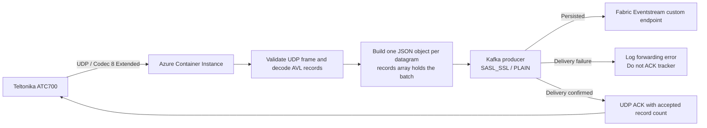

# ATC700 UDP Receiver

A .NET 10 service that receives Teltonika ATC700 UDP datagrams using Codec 8 Extended (`0x8E`), decodes AVL records, forwards each decoded JSON message to a Kafka-compatible Eventstream custom endpoint, then acknowledges the tracker after Kafka confirms persistence.

## Architecture



## Message Processing

Each valid UDP datagram produces one JSON log object. If a datagram contains several AVL records, they appear as elements in its `records` array. The message includes a UTC ingestion timestamp, device IMEI, sender, record count, decoded GPS fields, and I/O values.

Known ATC700 I/O IDs are emitted with camelCase names and typed values where documented. For example, alarm I/O `236=0x01` is represented as `name: "alarm"`, `value: true`, and sets `alarmButton` to `"pressed"`. Unmapped I/O IDs retain their numeric ID and raw hex value.

Malformed or unsupported datagrams are logged as JSON with `decodeStatus: "error"`, a reason, and the raw datagram in hex. They are not forwarded or acknowledged. A valid message is acknowledged to the tracker only after Kafka confirms persistence. If Kafka succeeded but the UDP ACK is lost, a tracker retry can result in duplicate delivery; this is at-least-once forwarding.

## Requirements

- .NET 10 SDK for local builds and the test client.
- Azure CLI with an authenticated subscription for deployment.
- A globally unique Azure Container Registry name and an available ACI DNS label.
- A Fabric Eventstream Kafka custom endpoint with SAS key authentication. The ACI must be able to reach its Kafka endpoint on port `9093`.
- ATC700 configured for UDP, Codec 8 Extended, and the deployed hostname/UDP port.

## Local Development

Build the receiver and test client:

```powershell
dotnet build src/Atc700Receiver/Atc700Receiver.csproj -c Release
dotnet build tools/Atc700Receiver.TestClient/Atc700Receiver.TestClient.csproj -c Release
```

Set the Kafka environment variables listed below, then start the receiver in one terminal:

```powershell
dotnet run --project src/Atc700Receiver/Atc700Receiver.csproj
```

Send a two-record sample batch from another terminal:

```powershell
dotnet run --project tools/Atc700Receiver.TestClient/Atc700Receiver.TestClient.csproj -- 127.0.0.1 5027
```

The test client emits a synthetic alarm record; it does not press a physical tracker button.

## Kafka Configuration

The receiver reads these container environment variables:

| Variable | Purpose |
| --- | --- |
| `UDP_PORT` | UDP listener port; defaults to `5027` |
| `KAFKA_BOOTSTRAP_HOST` | Kafka-compatible endpoint hostname, without a port |
| `KAFKA_PORT` | Kafka port; set to `9093` for the Eventstream endpoint |
| `KAFKA_TOPIC` | Eventstream endpoint's entity path/topic |
| `KAFKA_SECURITY_PROTOCOL` | `SASL_SSL` |
| `KAFKA_SASL_MECHANISM` | `PLAIN` |
| `KAFKA_SASL_USERNAME` | `$ConnectionString` |
| `KAFKA_SASL_PASSWORD` | Full SAS connection string |

The deploy script reads the SAS connection string from `infra/local.parameters.json` by default. Create it from the placeholder template:

```powershell
Copy-Item infra/local.parameters.example.json infra/local.parameters.json
```

Replace the placeholder with a **rotated** connection string. Do not commit or paste the SAS key into chat. The file is ignored by `.gitignore`; it is plaintext on disk, so restrict access. Bicep declares the parameter secure and ACI receives it as a secure environment variable. The ACR build context is limited to `src/Atc700Receiver`, excluding the local parameter file.

The script derives `KAFKA_BOOTSTRAP_HOST` from the connection string's `Endpoint` and `KAFKA_TOPIC` from `EntityPath`. It uses TLS and waits for persisted Kafka delivery before acknowledging each tracker datagram.

## Azure Deployment

Sign in and verify the target subscription:

```powershell
az login
az account show
```

From the repository root, deploy to an existing or new resource group:

```powershell
.\infra\deploy.ps1 `
  -ResourceGroup <resource-group> `
  -AcrName <globally-unique-acr-name> `
  -DnsLabel <available-dns-label> `
  -UdpPort 5027 `
  -KafkaParametersFile local.parameters.json `
  -Location westeurope
```

`KafkaParametersFile` can be a path relative to `infra/` or an absolute path. The script previews the Bicep deployments, builds and pushes the image to ACR, then deploys the ACI. It prints the resulting hostname, formatted as `<dns-label>.westeurope.azurecontainer.io`.

The current Azure deployment uses resource group `teltonika-atc700-weu-rg`, UDP port `5027`, and hostname `teltonika-atc700-20261017.westeurope.azurecontainer.io`. Azure Container Instances and ACR are billable resources.

## Test and Logs

Test the deployed endpoint:

```powershell
dotnet run --project tools/Atc700Receiver.TestClient/Atc700Receiver.TestClient.csproj -- <hostname> 5027
```

Read the ACI runtime logs:

```powershell
az container logs --resource-group <resource-group> --name atc700receiver
```

Kafka connection establishment, failures, and re-establishment are logged. A missing Kafka connection or unsuccessful delivery prevents the receiver from ACKing the tracker, allowing it to retry.

## Further Documentation

See [docs/message-processing.md](docs/message-processing.md) for packet framing, JSON fields, known ATC700 I/O mappings, alarm interpretation, and protocol sources.